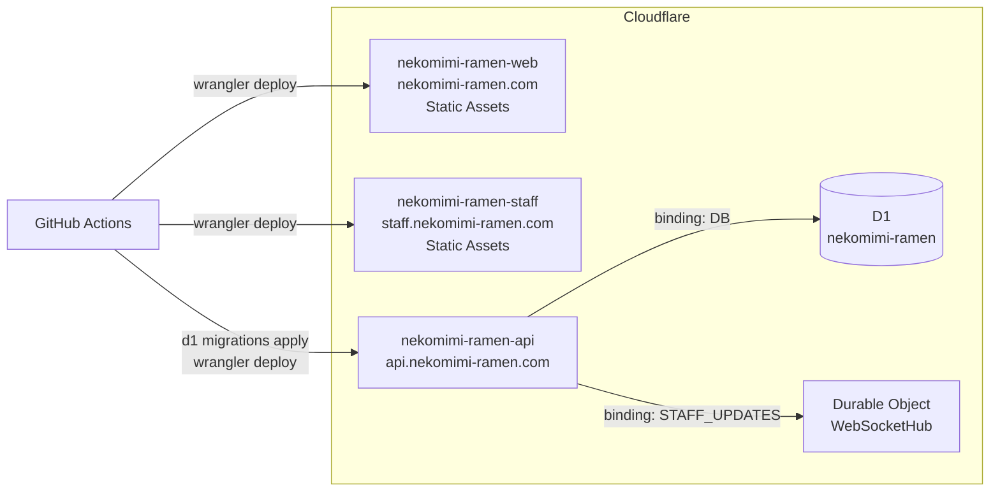
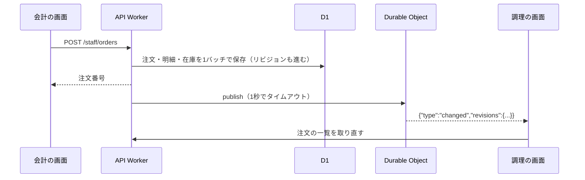

こんにちは、こうちゅけです。
先日開催された茨城高専の文化祭「茨香祭」で、高専生活最後の出し物「猫耳メイドラーメン」の注文システムを作りました。

出し物の名前を聞いて「？？」となると思いますが、「猫耳をつけたメイドさんが、ラーメンを萌え萌えしながら提供する」という、180度かけ離れた2つを掛け合わせたコンセプトです。

夏休みの1ヶ月を犠牲にして作成した、おそらく学生最後の超大作についてまとめたいと思います！

https://nekomimi-ramen.com

https://github.com/koutyuke/nekomimi-maid-ramen


## Vue Fesと同じ日に文化祭があった

第34回茨香祭は2026年10月24日（土）と25日（日）に開かれました。一般公開は24日だけで、25日は学内限定です。

https://34.shikosai.net/

一般公開の24日はVue Fes Japan 2026の開催日でもありました。自分は学生支援制度でVue Fesに参加していたので、一般公開の日は文化祭の会場にいませんでした。

https://zenn.dev/koutyuke/articles/vuefes-japan-2026

注文システムを使うのは、会計、調理、受け渡しを担当するクラスメイトです。作った本人がその場にいなくても業務は回るので、当日の運用はクラスに任せて、自分は遠隔で様子を見ていました。とはいえ、サーバーが落ちれば紙の伝票に戻すしかありません。セッションを聞きながらも、落ちないかずっと気が気ではありませんでした。

結果として一度も落ちずに文化祭を終えることができたんですが、当日はそんなこと分かるはずもなく...

しかもほとんど同じ構成で当日に落ちたというブログがあり、落ち着いてセッションを見てられませんでしたね...

https://x.com/ast_24_/status/2102778498838581489?s=20

## 出し物「猫耳メイドラーメン」

先ほど書いたとおり、メイドさんがラーメンを出すというコンセプトの出し物です。メニューとしてはラーメン、餃子、飲み物5種の合計7種類を販売しました。
計画の段階では2日間の確定注文を400件と見込んで設計していました。

店の流れは次のとおりです。

```text
[来場者が口頭で注文する]
        │
        ▼
[会計担当が入力・会計・確定する] ───▶ 番号札をお客さんに渡す
        │
        ▼
[調理担当がラーメンと餃子を作る]
        │
        ▼
[受け渡し担当が飲み物を用意し、注文番号を照合して渡す]
```


### 要件のまとめ

口頭だけで会計から調理へ注文を伝えると、注文漏れや取り違えが起きます。手計算による会計ミスや、売り切れた商品の注文を受けてしまうことも心配でした。そこで、担当ごとに次のことをシステムでできるようにしました。

| 担当         | システムでできること                                                     |
| ------------ | ------------------------------------------------------------------------ |
| 来場者       | 公開サイトで出店場所、営業時間、メニューと価格を確認する（ログイン不要） |
| 会計担当     | 商品と個数を入力し、合計とお釣りを確かめて注文を確定する                 |
| 調理担当     | ラーメンと餃子の注文を一覧で見て、未調理・調理中・完成を更新する         |
| 受け渡し担当 | 飲み物を用意し、注文番号を照合して受け渡しを完了にする                   |
| 出店責任者   | 価格の変更、売上の集計、スタッフの権限の管理                             |

注文を確定すると、在庫が減り、注文番号が発行され、調理の画面に注文が出ます。

作らないものも先に決めました。来場者のログイン、オンライン決済、事前注文は対象外にし、実装量が極力少なくなるようにしました。

## システムの構成


システムはすべてCloudflare上で動いています。公開サイト、スタッフ画面、APIを、それぞれ別のWorkerにしました。注文や在庫はD1に保存し、データが変わったことをDurable Objects経由のWebSocketでスタッフ画面へ知らせています。

公開サイトとスタッフサイトは要件がかけ離れていたので、実装の境界を引く意味であえて分けています。

### 技術スタック

| 対象                         | 主な技術                                                                         |
| ---------------------------- | -------------------------------------------------------------------------------- |
| 公開サイト（`apps/site`）    | React 19、Vite 8、TanStack Router、Tailwind CSS 4、Radix Colors、Base UI、Motion |
| スタッフ画面（`apps/staff`） | React 19、Vite 8、Mantine 9、TanStack Router、TanStack Query、Jotai、Eden Treaty |
| API（`apps/api`）            | Elysia 1.4、Effect 3、Drizzle ORM、Better Auth                                   |
| 共通                         | TypeScript 6、pnpm workspace、Turborepo、Vitest 4、oxlint、oxfmt、Nix            |

### Cloudflareの構成



## こだわったこと

### 公開サイトのデザインとアニメーション

公開サイトはデザインも含めてほとんど自分で作りました。メイドとラーメンというかけ離れた2つの概念を融合させるデザインは結構難しく、デザインだけで1週間もかかってしまいました...

アニメーションは、メニューのカードをタップするとカードが大きくなって開くなど、心地よく使えるようにしました。

動きにはMotionを使い、カラートークンとしてはRadix Colorsを採用しました。


見た目のために重くはしたくなかったので、表示の速さにも気を配りました。

- 写真はAVIFにし、表示する幅に合わせた`srcset`で配信する
- Webフォントはビルド時に使う文字だけに絞って自分のドメインから配信する
- 画面の外にある飲み物やフッターのSVGは、遅延読み込みにする

などなど。まだまだ最適化の余地はあったと思いますが、過度な最適化でコードが汚くなっても嫌なのである程度で妥協しました。(Lighthouseのスコアを90点台に載せたかった...)

### スタッフ画面は入力しやすく、必要な情報だけに絞る

スタッフ画面は、慣れていないクラスメイトが当日いきなり使います。そのため、迷わず操作できることを優先しました。

会計の画面では商品の行ごとに「−」「個数」「＋」を並べ、タップだけで個数を変えられるようにしました。商品の金額は100円単位で、入力する金額も100円単位になるため末尾の「00」を固定して大きく表示するようにしました。
画面内のテンキーのほか、「+100円」から「+10,000円」までのボタンで金額を足せるので、受け取ったお札をそのまま押せばお釣りが出るような工夫をしています。


調理の画面では注文を1件ずつカードにしています。
表示する商品は「すべて」「ラーメンだけ」「サイドだけ」で絞れて、作り終わった注文は隠せるようにしています。
カードは調理中、未調理、対応済みの順に並べ、上から作っていけば必然的にお客さんの優先順になるように工夫しています。
飲み物は受け渡し担当が用意するため調理の画面には出さず、受け渡し側のページでステータスを変更できるようにしています。


### スタッフ画面のリアルタイム同期

会計で確定した注文は数秒以内に調理と受け渡しの画面に出る必要があります。注文を確定してから、ほかの画面に届くまでの流れは次のとおりです。



データを持つのはD1だけにして、WebSocketでは「どのデータが変わったか」を示すリビジョンだけを送ります。データの中身は、受け取った画面がHTTPで取り直すようにしています。こうすると、WebSocketで届く内容とD1の内容が食い違うことはありません。

リビジョンはD1のトリガーで、注文の保存と同じトランザクションの中で進め、保存が取り消されたのにリビジョンだけが進むことがないようにしています。

WebSocketが切れていても、画面がおかしくならないようにしました。

- 通知に失敗しても、注文の確定は成功として返す（失敗はログに残す）
- スタッフ画面は30秒ごとにリビジョンを照合し、取りこぼした変更を取り直す
- 再接続は待ち時間を指数関数的に延ばし、ゆらぎ（ジッター）を加え、最大30秒にする
- 画面に戻ったときや通信が復帰したとき（`visibilitychange`、`online`、`pageshow`）は、すぐに取り直す

Durable Objectは店全体で1つだけ使い、WebSocketはHibernation APIで受け付けるようにしています。接続を保ったままDurable Objectを休ませられるので、注文が来ない時間に料金がかさみません。

https://x.com/koutyuke0808/status/2098891664307957842?s=20

### APIはEffectで層を分ける

APIのコードは業務の領域ごとに`menu`、`orders`、`realtime`、`staff`の4つに分けました。それぞれの中を、さらに層で分けています。

```text
apps/api/src/features/orders/
├── domain/              # 注文の型と業務のルール
├── application/
│   ├── use-cases/       # confirm-order.ts など
│   └── ports/outbound/  # リポジトリなどのインターフェース
├── adapters/            # ほかの領域（menu、realtime）への接続
├── infra/               # D1を使う実装（Drizzle）
└── layer.ts             # 実装をまとめたLayer
```

ユースケースが使うリポジトリなどは、Effectの`Context.Tag`で定義するようにしました。

```ts:apps/api/src/features/orders/application/ports/outbound/order-confirmation.command.ts
export class OrderConfirmationCommand extends Context.Tag("OrderConfirmationCommand")<
  OrderConfirmationCommand,
  {
    readonly execute: (
      draft: OrderDraft,
    ) => Effect.Effect<Order, ConfirmationLostStockRace | DuplicateConfirmation | PersistenceError>;
  }
>() {}
```

実装は`Layer`で渡すので、テストではモックの`Layer`に差し替えられます。失敗の種類が型に出るため、呼び出し側でどのエラーを処理し忘れているかを型検査で見つけられます。

層や領域をまたぐ`import`は、oxlintの`no-restricted-imports`で禁止しています。ユースケースを`Effect.gen`で書くことも、自作のoxlintプラグインで検査しています。AIに実装を任せても構造が崩れないのは、この検査のおかげです。

### EffectとElysiaとCloudflareのつなぎ込み

Worker上では`cloudflare:workers`の`env`から各領域の`Layer`を組み立て、`ManagedRuntime`を1つ作る必要があります。

```ts:apps/api/src/bootstrap/runtime.ts
const RealtimeLayer = makeRealtimeLayer(env.STAFF_UPDATES);
const MenuLayer = MenuServices.pipe(Layer.provide(RealtimeLayer));
const OrdersLayer = OrderServices.pipe(Layer.provide(Layer.mergeAll(MenuLayer, RealtimeLayer)));
const AppLayer = Layer.mergeAll(
  RealtimeLayer,
  MenuLayer,
  OrdersLayer,
  makeStaffLayer(env.DB, {
    /* 認証の設定 */
  }),
).pipe(Layer.provide(makeDatabaseLive(env.DB)));

export const runtime = ManagedRuntime.make(AppLayer);
```

Elysiaのルートではこの`runtime`でユースケースを実行します。実行に使う関数は、エラーの型が`never`の`Effect`しか受け取りません。そのため、ユースケースが返すエラーを`catchTag`でHTTPのステータスに対応させないと、型検査を通りません。想定していない失敗は`logAndDie`でログに残し、内部の情報を出さずに500を返すようにしています。

```ts:apps/api/src/routes/orders/confirm-orders.route.ts
const outcome = await run(
  logAndDie(
    confirmOrder(body).pipe(
      Effect.map((order) => ({ status: 201, body: presentConfirmedOrder(order) }) as const),
      Effect.catchTag("OutOfStock", (error) =>
        Effect.succeed({ status: 409, body: presentOutOfStock(error.shortages) } as const),
      ),
      Effect.catchTag("InvalidOrderInput", (error) =>
        Effect.succeed({ status: 422, body: { code: "invalid_order", reason: error.reason } } as const),
      ),
      // 他のエラーも同様に対応させる
    ),
  ),
);
```

リクエストの検証にはEffect Schemaを`Schema.standardSchemaV1`でElysiaに渡しています。OpenAPIのスキーマも同じEffect Schemaから作り、公開しています。

https://api.nekomimi-ramen.com/openapi

つなぎ込みで一番はまったのはWebSocketです。Elysia 1.4.30のCloudflareアダプターは、レスポンスを作り直すときにWorkers独自の`webSocket`プロパティを落とします。そのため、Durable Objectから返したステータス101のレスポンスだけは、作り直さずにそのまま返すアダプターを用意しました。

### 注文確定の整合性

注文の確定では、注文の保存と在庫の減算が両方成功するか、両方失敗するかのどちらかにする必要があります。D1は1つのトランザクションの中で読んでから書く処理（対話型トランザクション）に対応していません。そこで、注文、明細、在庫の減算を`db.batch`で1回にまとめて実行し、ルールは表の制約で守ることにしました。

```ts:apps/api/src/features/orders/infra/commands/order-confirmation.command.live.ts
db.batch([
  db.insert(orders).values({
    // 注文番号は営業日ごとの最大値+1をINSERT文の中で決める
    orderNumber: sql`(select coalesce(max(order_number), 0) + 1 from orders where business_date = ${businessDate})`,
    requestId: draft.requestId,
    // ...
  }),
  db.insert(orderLines).values(/* 明細 */),
  ...draft.lines.map((line) =>
    db
      .update(stocks)
      .set({ quantity: sql`${stocks.quantity} - ${line.quantity}` })
      .where(eq(stocks.menuItemId, line.menuItemId)),
  ),
]);
```

在庫は`CHECK (quantity >= 0)`で不整合になるような数値を排除しています。在庫が足りなければ制約違反になり、バッチ全体が取り消されます。

## 大変だったこと

### 要件定義

一番難しかったのは要件定義です。メニュー、価格、役割分担などはクラスで決めることで、決まるのを待ちながら仕様を固める必要がありました。定期的に開かれる作戦会議のたびに仕様がコロコロ変わり、頭を悩ませながらどうにか落とし込むのが本当に大変でした。

どこまで作るかの線引きにも悩みました。セット割のような複雑な料金は、今回は作れませんでした。来場者が事前に注文を選ぶようなシステムは、はじめは要件に入っていましたが、途中で落とすことにしました。

### 公開サイトのデザインとアニメーション

次に大変だったのがサイトのデザインです。当初はメイドカフェとラーメン屋のどちらかを出す予定でしたが、クラスの意見がちょうど真っ2つに割れ、最終的に2つを融合させることになりました。そのため両方のコンセプトをデザインに落とし込む必要があり、本当に悩みました。

特に、カードが詳細に広がるアニメーションには苦労しました。縮んで戻るときにカードが揺れる、広がる途中で商品の画像がゆがんだりぼやけたりする、といった問題を、何日もかけて何度も直しています。


## そこまで大変じゃなかったこと

そんなに大変ではなかった点としては圧倒的に実装ですね。
自分の中でディレクトリ構成やアーキテクチャ、デザインパターンなどはほとんどベストプラクティスのようなものが決まっているのでそれをドキュメントに起こしてそれに従わせるだけ。あとは oxlint 等でそれを禁止するようにしてやればそこまでおかしな実装にはならないのであとは LLM を使って作って終わりになることが多かったですね。

技術選定もそこまで時間はかかりませんでした。自分は Next.js しか使ってこなかったのですが、1年ぶりにフロントエンドを触る際にせっかくなら Vite 中心の構成にしてやろうと決めており、それを LLM を使って具現化させただけなので設定とかはほとんどしていません。

プロジェクトの設定もデザインに比べたら超絶楽勝でした。tsconfig には tsconfig/bases を使っていますし、環境は Nix で固定、CI等は以前自分が作ったやつを参照させて改良したものになるのでほとんど自分は迷いませんでした。literやformatter には oxlint/oxfmt を採用しており、eslintやprettier の時代に比べたらゼロコンフィグみたいなものんですからね。

結論としては実装よりデザインと要件定義が一番時間と頭を悩ませた点かなぁって感じです

## 次に同じようなものを作るなら

まず、ツールを変えたいです。今回はモノレポのツールにTurborepoを使いましたが、次はVite+とVoidにしたいと考えています。

公開サイトは静的なサイトなので、次はAstroで作りたいですね。アニメーションもJavaScriptのライブラリを使わず、CSSだけで実現したいものです。

最後に、今回作れなかったセット割のような複雑な料金にも対応したいですね。

## おわりに

8月の終わりから2か月ほどで、公開サイト、スタッフ画面、APIを作りました。Vue Fesの会場から見守るだけで、2日間システムが止まらずに動いてくれたのは本当にうれしかったです。

ラーメンは業スーのラーメンスープではなく、ラーメン屋さんから仕入れた本物(?)のラーメンでした。そのためとても好評で、延べ500食の在庫が一瞬でなくなり、なんと40万円近くを売り上げました。
予算を差っ引いても飲み代が余裕で出るぐらいには売れて本当に楽しかったです！

CloudflareでのドメインだとPaid Planを丸々出してくれてこちらとしてもいい体験ができました。

当日システムを使って店を回してくれたクラスメイトのみんな、ありがとうね！！
